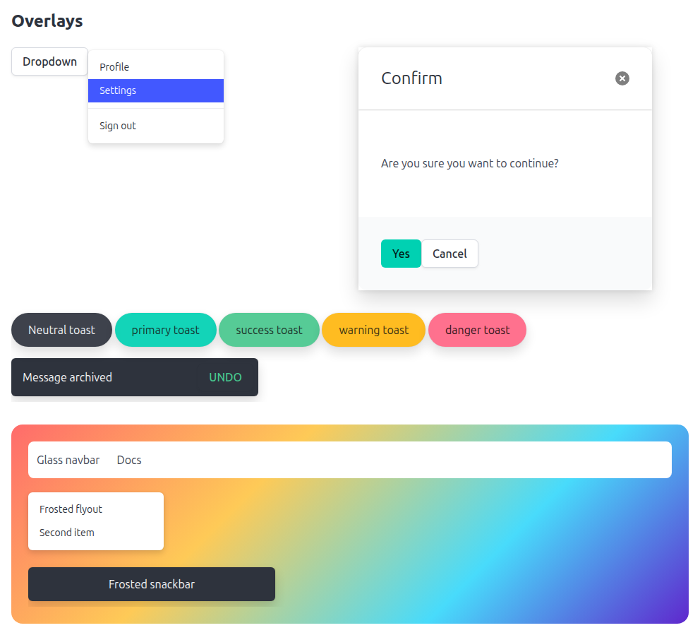
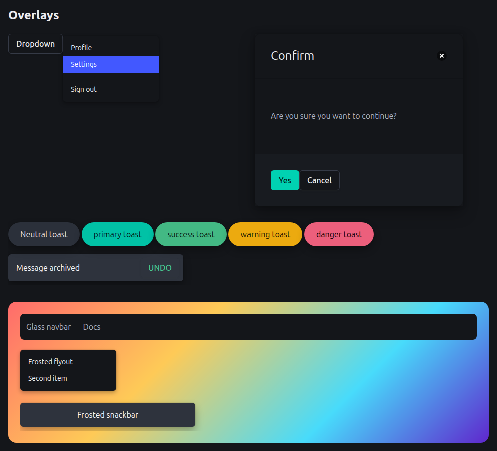
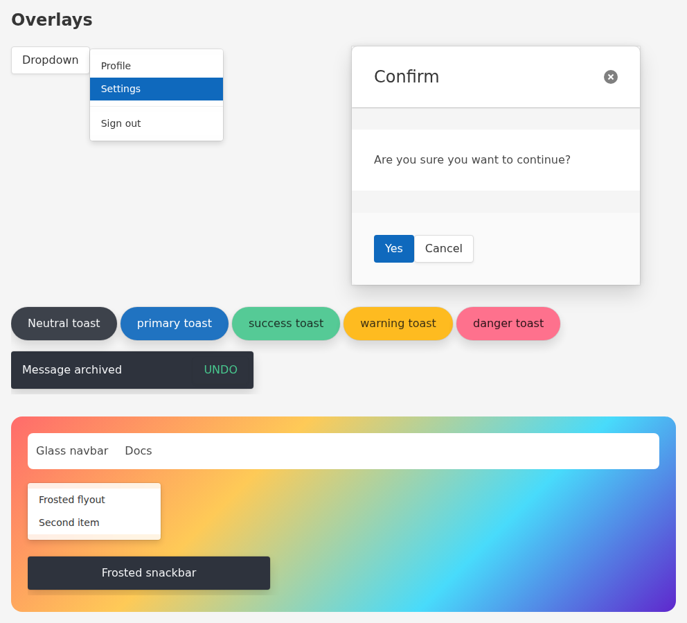
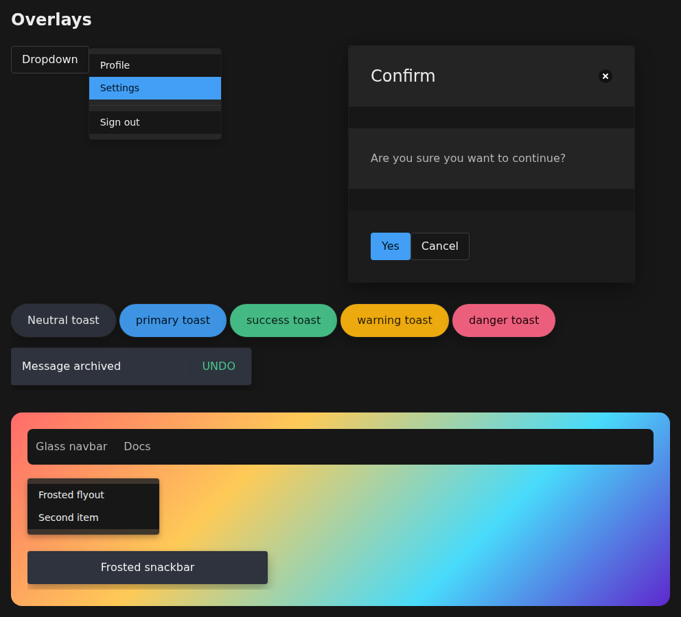
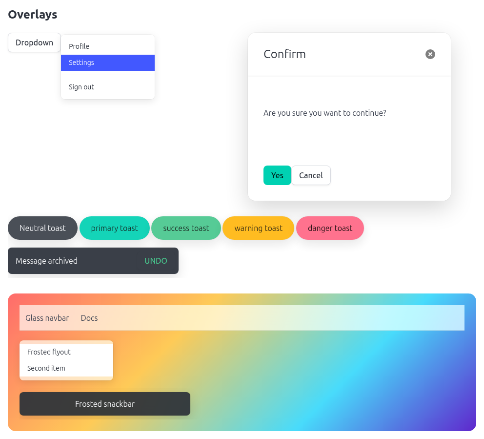
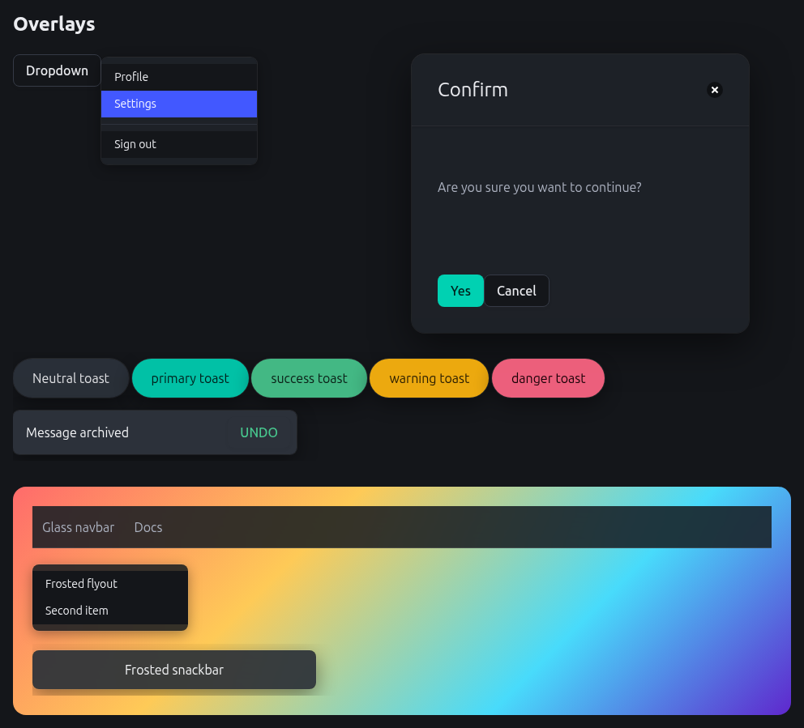

# @buefy/themes

Official themes for [Buefy](https://buefy.org) (Vue 3, built on Bulma v1). They add elevation, restrained materials, purposeful motion and calmer hierarchy, with no changes to your markup and no runtime JavaScript.

> **Status: 0.1.0, not yet published to npm.** All three themes and the multi-theme entry are implemented and tested. See [CHANGELOG.md](CHANGELOG.md) and the [limitations](#limitations).

## Usage

```sh
npm install @buefy/themes buefy
```

### One theme

Import **one** theme entry; it applies to the whole document immediately. Do not import more than one standalone entry.

```js
import 'buefy/dist/css/buefy.css'
import '@buefy/themes/fluent'   // or /elevated, /glass
```

### Several themes, switched at runtime

The root entry bundles all three themes, but every rule is scoped to `<html data-buefy-theme="NAME">`, so importing it changes nothing until you pick one.

```js
import 'buefy/dist/css/buefy.css'
import '@buefy/themes'
```

```html
<html data-buefy-theme="fluent">
```

```js
document.documentElement.dataset.buefyTheme = 'glass'   // switch
delete document.documentElement.dataset.buefyTheme      // back to plain Buefy
```

The attribute must be on `<html>` (themes are page-wide, not per subtree). It is independent of Bulma's light/dark switch and composes with it:

```html
<html data-buefy-theme="fluent" data-theme="dark">
```

Tests verify that the root entry renders **exactly** like the matching standalone entry, on every computed property of every element, in light and dark.

### Sass

```scss
@use "pkg:@buefy/themes/fluent";
```

The Sass route imports Bulma's mixins, so it needs `bulma` installed (an optional peer dependency).

#### Configuring the accent

`fluent` generates its blue accent with Bulma's own palette mixins at build time, so the accent is a Sass setting rather than a CSS variable (changing only a lightness in CSS would leave Bulma's derived shades and text colours stale).

```scss
// your own brand colour; the dark-mode accent is derived automatically
@use "pkg:@buefy/themes/fluent" with ($accent: #7957d5);

// ...or choose the dark-mode accent yourself
@use "pkg:@buefy/themes/fluent" with ($accent: #7957d5, $accent-dark: #b39cf0);

// ...or keep your own Bulma palette and take only the rest of the theme
@use "pkg:@buefy/themes/fluent" with ($accent: none);

// the root entry configures only its fluent scope
@use "pkg:@buefy/themes" with ($fluent-accent: #7957d5, $fluent-accent-dark: #b39cf0);
```

| Variable | Meaning |
|---|---|
| `$accent` | A colour, or `none` to skip palette generation. Default: Fluent blue (`#0f6cbd`). It drives `primary` and `link`. |
| `$accent-dark` | A colour for dark mode. Default: Fluent's dark blue (`#479ef5`), or, when only `$accent` is set, `$accent` lightened until it reaches 4.5:1 against the dark page. |

When you set `$accent`, the text on filled buttons is chosen as white or near-black, whichever has more contrast. This is tested for a spread of nine brand colours in both light and dark. One thing is **not** checked for you: in light mode, outlined and text buttons draw with the accent itself on a white page, so a very light accent (a yellow, say) can fall below 4.5:1 there. Pick a darker `$accent` in that case. Passing something that is not a colour fails the build with a message saying so.

`elevated` and `glass` have no accent setting; they keep Bulma's colours.

### For tools and AI agents

`@buefy/themes/manifest` is a JSON description generated at build time: theme names and one-line summaries, exact import statements, the activation attribute, every public `--buefy-*` token with its description (read from the Sass source), opt-in classes, accessibility guarantees and file sizes.

```js
import manifest from '@buefy/themes/manifest' with { type: 'json' }
```

| Subpath | Look |
|---|---|
| `@buefy/themes/elevated` | Conservative upgrade: keeps Bulma colours, adds a consistent four-level elevation scale, calmer motion, reduced-motion support and a visible focus ring. **Available now.** |
| `@buefy/themes/fluent` | Calm, precise, productivity-app feel: neutral two-layer surfaces, a generated blue accent, system font stack, tighter radii, hairline strokes, decelerate-in motion and acrylic-style frosted dropdown flyouts (solid fallback for reduced transparency, forced colours and older browsers). **Available now.** |
| `@buefy/themes/glass` | Frosted transient surfaces over an opaque page: dropdown flyouts, modal cards, neutral toasts and snackbars, plus an opt-in frosted navbar (`<nav class="navbar is-glass">`). Soft diffused shadows and rounder corners. Boxes, cards, tables, inputs and buttons stay opaque, and coloured toasts (`is-success`, `is-link`, …) keep Bulma's exact solid colour, because translucency would shift their meaning and break contrast. Everything has a solid fallback. **Available now.** |
| `@buefy/themes` | All three themes, inactive until `<html data-buefy-theme="…">` is set. |

CSS sizes (unminified / gzipped): `elevated` 5.5 KB / 1.0 KB, `fluent` 54.8 KB / 4.9 KB, `glass` 11.8 KB / 1.6 KB, all three 76.2 KB / 6.6 KB. Exact figures for each build are in the manifest, and CI enforces a budget (`size-budget.json`) so growth has to be deliberate. `fluent` is the largest because it generates a complete colour palette for both light and dark.

## Screenshots

Buefy overlays (a dropdown, a modal card, toasts and a snackbar) and a frosted-surface demo over a colourful backdrop, in light and dark. Regenerate them with `npm run docs:screenshots`.

| | Light | Dark |
|---|---|---|
| `elevated` |  |  |
| `fluent` |  |  |
| `glass` |  |  |

## Customising

### Tokens

Every theme is a set of values for these public custom properties, and they are the supported way to customise a theme. Components read them (through Bulma's own `--bulma-*` variables), so changing one changes every component that uses it. `dist/manifest.json` lists the same tokens.

| Token | Controls |
|---|---|
| `--buefy-elevation-1` | Resting surfaces: box, card |
| `--buefy-elevation-2` | Raised surfaces: navbar dropdown, dropdown, datepicker, tooltip |
| `--buefy-elevation-3` | Transient notices: toast, snackbar, notification |
| `--buefy-elevation-4` | Overlays: modal, sidebar |
| `--buefy-motion-duration-fast` | Hover and press feedback |
| `--buefy-motion-duration-normal` | Most state changes |
| `--buefy-motion-duration-slow` | Entrances of large surfaces |
| `--buefy-motion-ease-standard` | Default curve |
| `--buefy-motion-ease-decelerate` | Elements entering |
| `--buefy-motion-ease-accelerate` | Elements leaving |
| `--buefy-focus-ring-width` | Focus ring thickness |
| `--buefy-focus-ring-offset` | Gap between element and focus ring |
| `--buefy-focus-ring-color` | Focus ring colour |
| `--buefy-material-blur` | Backdrop blur radius for frosted surfaces |
| `--buefy-material-saturate` | Backdrop saturation multiplier |
| `--buefy-material-tint` | Surface tint laid over the blurred backdrop |
| `--buefy-material-border` | Hairline edge colour for material surfaces |
| `--buefy-surface-page` | Page background (the layer everything sits on) |
| `--buefy-surface-raised` | Cards, boxes, dropdowns, modal cards: the layer above the page |

Not every theme uses every token (`elevated` does not set the `material-*` tokens, for example), and not every component reads every token.

### Overriding a token

A theme sets its tokens with deliberately high specificity, so that it wins over Buefy's own CSS whatever the stylesheet order. That means a plain `:root { … }` rule in your app does **not** override it, and `:root:root { … }` only works in light mode. Use this selector, which beats every light, dark and `data-buefy-theme` variant of every entry:

```css
html:root:root:root:root:root {
  --buefy-elevation-2: 0 6px 20px rgb(0 0 0 / 0.18);
  --buefy-motion-duration-normal: 120ms;
}
```

This is tested for all three themes and the root entry, in light, dark and forced light/dark. An override applies to both colour schemes, so set the dark value yourself under `html[data-theme="dark"]:root:root:root:root:root` (and an `@media (prefers-color-scheme: dark)` block) if the two should differ. A forced-dark or forced-light subtree (`data-theme` on an inner element) sets its own tokens and is not reached by a root override.

## Frosted material and accessibility

Frosted surfaces (`fluent` flyouts, `glass`) are translucent over a blurred backdrop. They fall back to a solid surface when `backdrop-filter` is unsupported, under `prefers-reduced-transparency`, and in forced-colors mode. Each fallback is exercised in a real browser.

What the test suite checks, in light and dark:

- **Contrast:** WCAG AA (4.5:1) for text on frosted surfaces over worst-case pure black and pure white backdrops, and for button text, body text and the focus ring (3:1).
- **axe-core audit** of a component gallery (WCAG 2.0, 2.1 and 2.2, levels A and AA). A theme must add no violation that plain Buefy does not already have. Plain Buefy itself has two contrast issues in the gallery (the default turquoise outlined button on white, and the `is-light` tag in dark mode); the themes neither add nor fix them, except that `fluent` replaces the turquoise.
- **Visual regression:** screenshots of the gallery for every theme in light and dark, at desktop and mobile width, and right-to-left. Text is rendered transparent so results do not depend on installed fonts.
- **Reduced motion, reduced transparency and forced colors** are emulated and verified.

Custom colours added through Bulma's `$custom-colors` are not part of the standard-colour exclusion list, so verify the contrast of any custom-coloured toast under `glass`.

## Browser support

The build targets Chrome and Edge 100, Firefox 100 and Safari 15.4 or newer, and keeps the `-webkit-backdrop-filter` prefix older Safari needs. Frosted surfaces need `backdrop-filter` (and `color-mix()` for notices) and fall back to solid surfaces where those are missing, so older browsers still get a fully working, just not frosted, interface.

**Tested in Chromium and Firefox, not in Safari.** The real-browser tests (theme behaviour, the axe audit, the playground) run in headless Chromium and in Firefox on every push. The screenshots (visual regression) and the `prefers-reduced-transparency` tests are Chromium-only: Firefox cannot emulate that preference, and visual baselines are per browser. WebKit/Safari is **not** tested, so the `-webkit-backdrop-filter` path and Safari's rendering are unverified.

Run the browser tests in Firefox yourself with `BROWSER=firefox npm run test:cascade` (after `npx playwright-core install firefox`).

## Limitations

These are known and intentional for 0.1.0:

- **Only the `fluent` accent is configurable from Sass.** Everything else is customised through the CSS tokens above. There is no Sass setting for fonts, radii or the glass tint yet.
- **One standalone theme per page.** Do not import two standalone entries. Use the root entry to switch.
- **The theme attribute belongs on `<html>`.** Themes are page-wide, not per subtree. Light/dark does work per subtree.
- **Custom colours** (Bulma's `$custom-colors`) are not themed by `fluent`'s generated palette, and `glass` may frost a custom-coloured toast that has not been checked for contrast.
- **Not themed:** the shadow on Buefy's mobile table cards (it is set inside a media query), the carousel's slide easing, and Bulma's named grey shades, which stay blue-grey under `fluent`.
- **Plain Buefy's own contrast issues remain.** The audit only fails on issues a theme adds; see the accessibility section.
- **Not tested:** Safari/WebKit, Nuxt itself (the SSR build is tested with Vite), and any bundler other than Vite.
- **Visual baselines were generated on Linux.** If CI renders slightly differently, regenerate them there.

## Disclaimer

The `fluent` theme is inspired by Microsoft's Fluent Design System. This project is not affiliated with or endorsed by Microsoft, and ships no Microsoft fonts, icons or assets.

## Development

Requires Node 20 or newer (`.nvmrc` pins 22).

```sh
npm install
npm run build    # compile src/entries/* to dist/
npm test         # build, exports check, size budget, publint, unit + contract + real-browser + visual tests
npm run test:consumers  # pack the tarball, install it into a fresh project, use it from Vite/Sass/TS/Node (needs network)
npm run playground  # after a build: open playground/dist/index.html (THEME=fluent|glass|all)
```

Browser tests use Playwright; install the browser once with `npx playwright-core install chromium-headless-shell`.

Visual baselines live in `tests/visual/baseline/`. After an intentional visual change, review the result with `npm run playground` and regenerate them with `UPDATE_VISUAL=1 npm run test:visual`. A failed comparison writes the actual image and a diff to `tests/visual/__diff__/` (git-ignored).

### How a theme is built

A theme only supplies values for the public `--buefy-*` tokens (`src/core/_tokens.scss`). `src/core/_mapping.scss` binds those tokens to the `--bulma-*` variables components read, on the same selectors Buefy uses so they win in the cascade. `tests/contract.test.mjs` fails if a selector or variable we override disappears from the installed Buefy.

Each theme (`src/themes/<name>/_index.scss`) exposes one `output($name: null)` mixin. The standalone entry calls it with no name; the root entry calls it with the theme name, which scopes every rule under `<html data-buefy-theme="NAME">`. Because both entries share that one mixin, they cannot drift apart.

### Releasing

1. Bump `version` in `package.json` (and move the `CHANGELOG.md` entry out of "Unreleased"), and merge to `main`.
2. Publish a GitHub release from `main` whose tag matches the version (`v0.1.0` for `0.1.0`).
3. The `Publish @buefy/themes to NPM` workflow runs the full test suite and the consumer install tests, then publishes with `npm publish`. A manual run (workflow dispatch) is also available.

Publishing uses npm [Trusted Publishing](https://docs.npmjs.com/trusted-publishers) over OIDC, so there is no token to store, and provenance is attached automatically. It needs a GitHub environment named `npm-publish` (restrict it to `main` and add required reviewers if you want an approval step), the `@buefy` npm org, and a trusted publisher configured for this repository and workflow on the package's npm settings page.

## License

[MIT](LICENSE)
